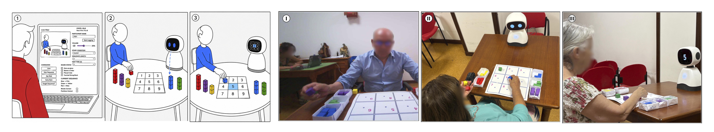

# "It Was Me Who Corrected It": Designing and Evaluating Autonomy-Preserving Robotic Support for Older Adults

Code, materials, and analysis scripts accompanying the HRI 2027 submission (paper title above).



## Contents

```
Elmo_Scripts/                Robot control system (Wizard-of-Oz FSM, hint behaviors, GUI dashboard)
    logs_deidentified/       Per-session interaction logs, de-identified (see below)
Data_Analysis/
    generate_report.py       Main statistics pipeline (self-report, manipulation check, behavioral)
    generate_figure2.py      Regenerates the self-report subscale figure from the raw pipeline
    run_tost.py              TOST equivalence tests for H2 outcome measures
    thematic_coded_excerpts.csv   Coded interview excerpts underlying the thematic analysis
    Thematic_Analysis_Report.md
    Preliminary_Analysis_Report.md
    h2_data_for_tost.csv     Per-participant behavioral metrics used by run_tost.py
    robustness/              Additional analyses (ANCOVA, site, TOST, Corsi, override rate); see below
    corsi/                   Corsi scoring script and de-identified trial data and scores
    raw_data_deidentified/   Survey responses and de-identified Corsi Block Task scores (see below)
```

## What's included and what's not

This repository shares the code and data needed to reproduce every statistic reported in the paper, while protecting the privacy of a vulnerable participant population (older adults, several recruited through nursing homes and daycare centers).

**Included:**
- All robot control and Wizard-of-Oz dashboard code.
- All analysis and statistics scripts.
- Session interaction logs, with absolute timestamps replaced by relative (seconds-since-session-start) timing and internal file paths removed (participant ID, event sequence, and relative timing retained, but not real-world dates/times).
- Survey response data (post-study questionnaires, manipulation check), and pre-study responses with demographic fields (age, sex, education, prior occupation) removed.
- Coded interview excerpts used in the thematic analysis.

**Not included:**
- Session video/audio recordings.
- Raw interview transcripts (the coded excerpts above are drawn from these).
- Pre-study demographic fields that, combined with small per-site sample sizes, could support re-identification.
- Any file mapping participant IDs to names.

Participant IDs used throughout (e.g. `P3`, `P22`, `P32`) match those used in the paper and supplementary material.

## Additional analyses (`Data_Analysis/robustness/`)

These scripts reproduce the robustness and supplementary analyses reported in the revised paper and supplement. They use only files in this repository. Each script starts with a docstring that explains the question, the method, the inputs and the output.

| Script | What it computes |
|---|---|
| `01_ancova_hints_duration.py` | Condition effect on Self-Reliance, BPNSS Autonomy and IMI Perceived Competence adjusted for hint volume (total hints, hint episodes) and session duration (OLS, N = 35); rank-transformed Self-Reliance |
| `02_site_adjusted.py` | Same outcomes adjusted for recruitment site, and the association of site with each outcome (needs `participant_site.csv`, not included, see below) |
| `03_tost_equivalence.py` | Equivalence tests (TOST, bound d = 0.5) for the H2 measures and trials, with 90% CIs and the smallest bound that would give p < .05 |
| `04_corsi_analysis.py` | Corsi score by condition (last-run and best-run rule), Spearman correlations with the outcomes, condition effects with and without Corsi as a covariate, and the condition x Corsi interaction (N = 32) |
| `05_corsi_game_metric_correlations.py` | Pearson and Spearman correlations of the Corsi score with every numeric behavioral log metric |
| `06_sequence_override_rate.py` | How often the sequence length was held or reset instead of advancing automatically |
| `07_manipulation_check_sensitivity.py` | Manipulation check items with and without the participant who answered negatively to the gate item, and questionnaire results with that participant excluded from the whole pipeline |
| `run_all.py` | Runs all scripts in order and writes `results_all.txt` |

`results_all.txt` holds the output of the last full run, so you can compare it with the numbers in the paper without running anything.

**How to run.** From `Data_Analysis/robustness/`:

```
pip install pandas numpy scipy statsmodels pingouin openpyxl matplotlib
python3 run_all.py                          # all scripts, writes results_all.txt
python3 04_corsi_analysis.py                # or one script at a time
```

The scripts load the main pipeline (`generate_report.py`) through `_pipeline.py`, which runs it inside a temporary copy of the repository layout. No file of this repository is modified when you run them. The Corsi scores are read from `corsi/corsi_scores_deidentified.csv`, which `corsi/corsi_scoring.py` produces from `corsi/corsi_trials_deidentified.csv`. Scores exist for 32 of the 35 participants because the results of three participants were not recorded due to a technical problem. Participants are identified by the same IDs as in the paper (`P1` to `P35`), and condition labels in the data are Portuguese (`Implícita` = Implicit, `Explícita` = Explicit).

**Withheld data.** The assignment of participants to recruitment sites is not included, because with a few participants per site it could support re-identification (see "What's not included"). `02_site_adjusted.py` documents the expected format (`participant_site.csv` with columns `new_id` and `site`) and is skipped automatically when the file is absent. The site-adjusted results can be shared with reviewers on request.

## Reproducing the analysis

`Data_Analysis/generate_report.py` is the main entry point; it reads from `raw_data_deidentified/` and `../Elmo_Scripts/logs_deidentified/` (relative to its own location) and regenerates `Preliminary_Analysis_Report.md`. `run_tost.py` and `generate_figure2.py` build on its output for the equivalence tests and the self-report figure, respectively.
